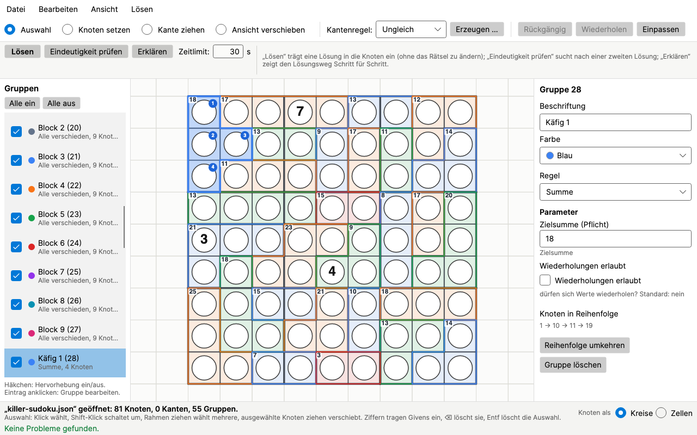
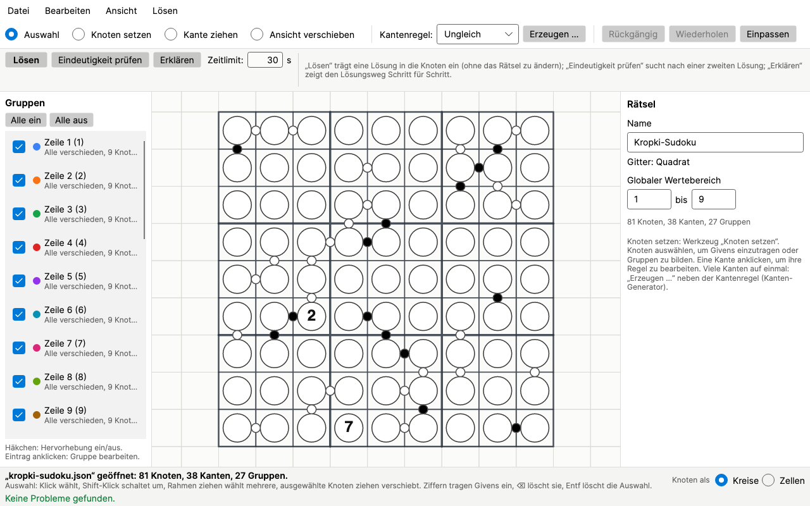
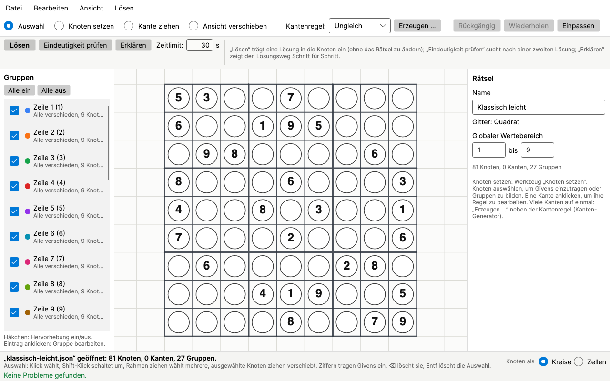
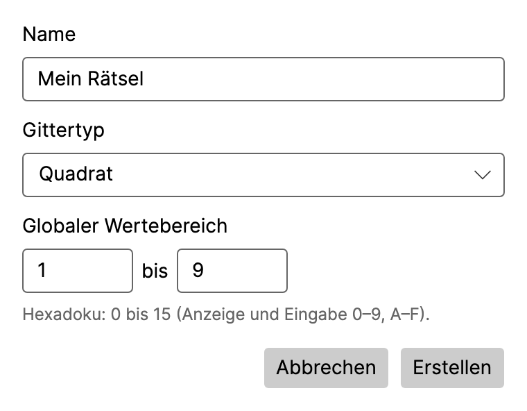
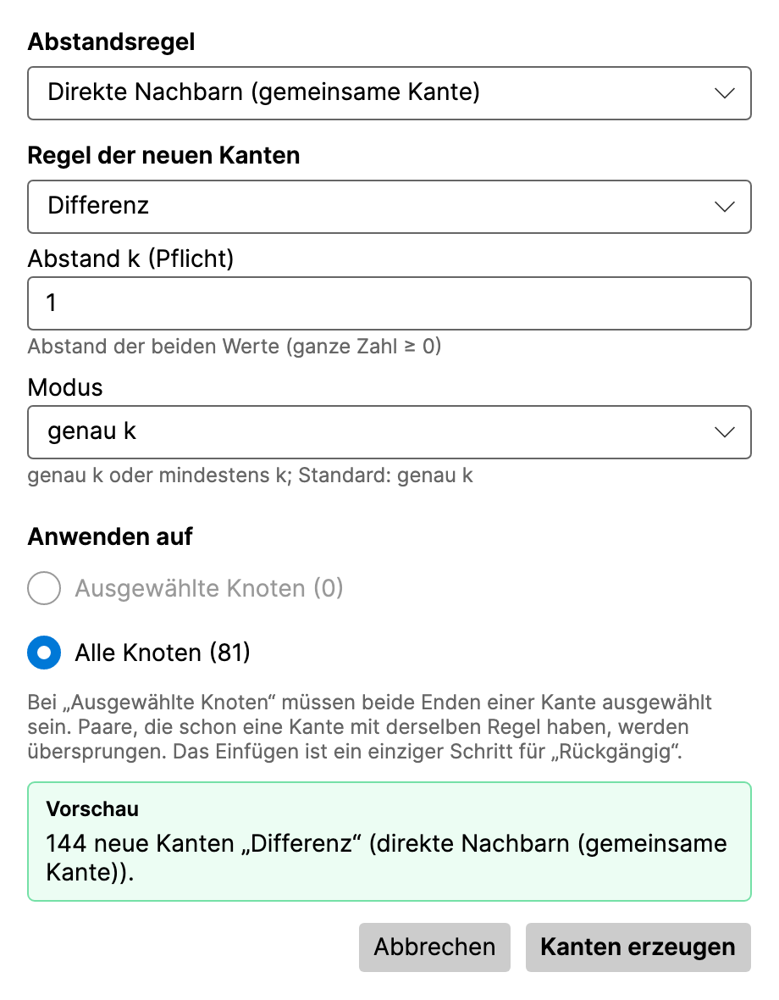
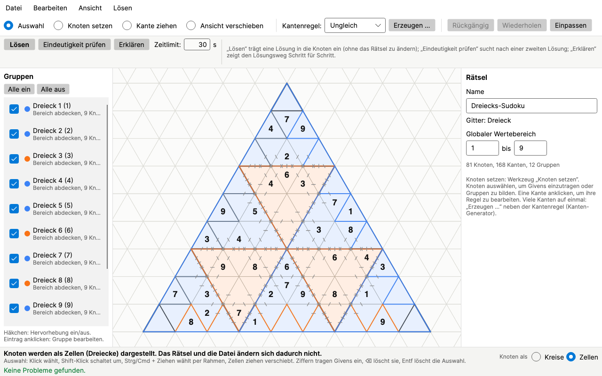
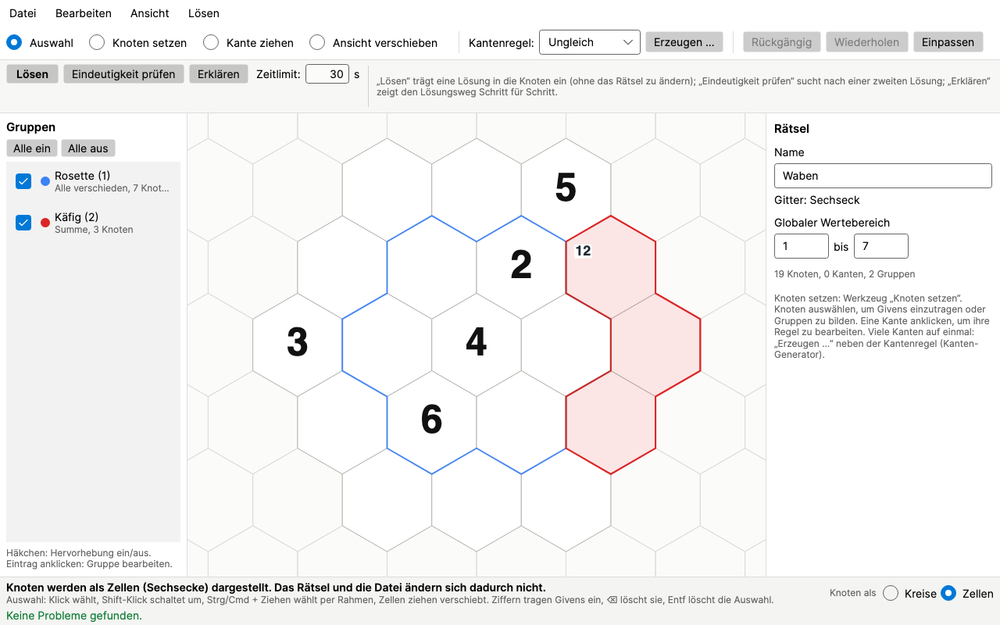
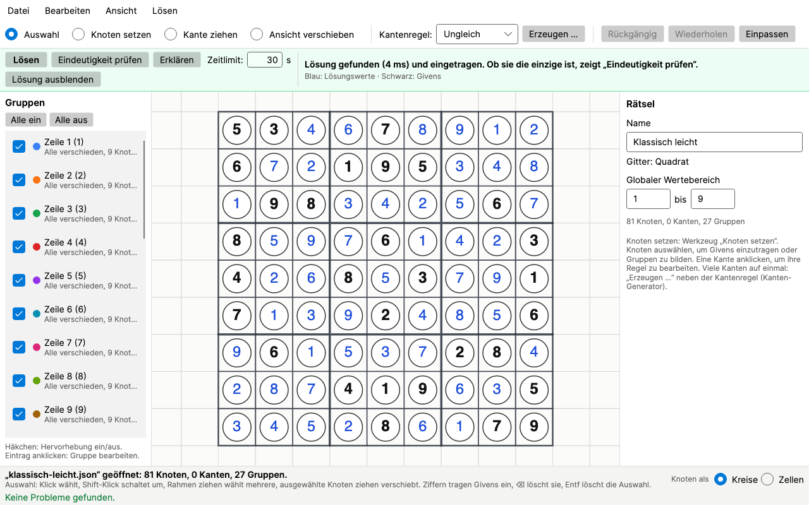
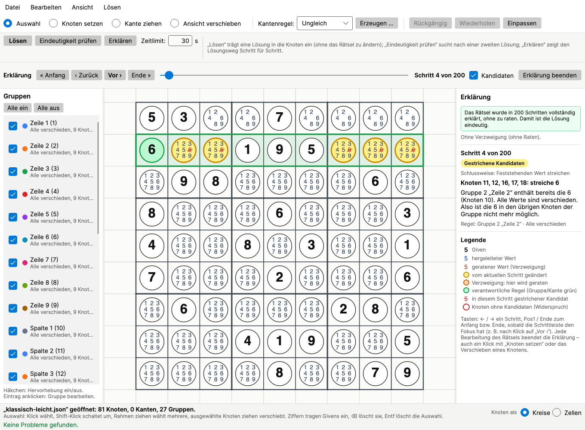
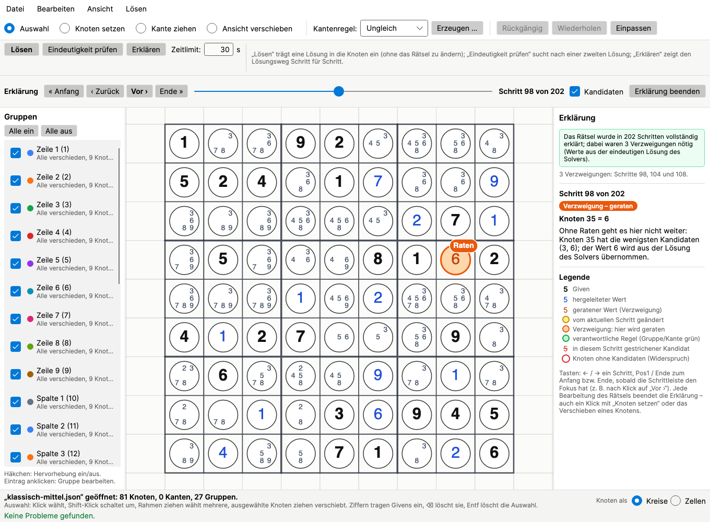

# Überblick

GraphDoku ist ein Werkzeug zum **Bauen, Lösen und Erklären von Sudoku-Varianten**. Statt fester Sudoku-Typen kennt es
nur drei Bausteine: **Knoten** (die Zellen), **Kanten** (Regeln zwischen zwei Zellen) und **Gruppen** (Regeln für eine
Menge von Zellen). Daraus lässt sich ein klassisches Sudoku genauso zusammensetzen wie ein Killer-, Kropki-, Thermo- oder
Dreiecks-Sudoku – oder ein ganz eigenes Rätsel.

Was GraphDoku kann:

- **Rätsel bauen** auf einem Quadrat-, Dreiecks- oder Sechseckgitter, mit Maus und Tastatur, mit Rückgängig und
  Wiederholen.
- **Lösen** mit dem Constraint-Solver Google OR-Tools und **prüfen, ob die Lösung eindeutig ist**.
- **Den Lösungsweg erklären**: Schritt für Schritt, mit Kandidaten, Begründung und markierten Rateschritten.

GraphDoku läuft unter Windows, macOS und Linux. Ein installiertes .NET ist nicht nötig. Rätsel werden als lesbare
JSON-Dateien gespeichert; neun Beispielrätsel liegen bei.

Dieses Handbuch beschreibt zuerst die **Installation** je Plattform, dann das **Konzept** (wie man Rätsel als Graph
modelliert) und die **Bedienung**. Am Ende stehen **Meldungen**, **Fehlerbehebung** und ein kurzer **Anhang**.

# Installation

GraphDoku hat keinen Installer. Jede Version gibt es als Archiv pro Plattform; man entpackt es und startet die App.
Es werden keine Einstellungen gespeichert und nichts außerhalb des Programmordners verändert.

## Welche Datei?

| Plattform | Datei | Starten |
| --- | --- | --- |
| Windows 10/11 (64 Bit) | `GraphDoku-<Version>-windows-x64.zip` | `GraphDoku.App.exe` |
| Mac mit Apple-Chip (M1 und neuer) | `GraphDoku-<Version>-macos-arm64.zip` | `GraphDoku.app` |
| Mac mit Intel-Prozessor | `GraphDoku-<Version>-macos-x64.zip` | `GraphDoku.app` |
| Linux (64 Bit, x86) | `GraphDoku-<Version>-linux-x64.tar.gz` | `GraphDoku.App` |

Welcher Mac? Apple-Menü → **Über diesen Mac**: Steht dort „Chip Apple M…“, ist es ein Mac mit Apple-Chip; steht dort
„Prozessor … Intel“, ein Intel-Mac.

Jedes Archiv enthält neben der App die Lizenz (`LICENSE`), die Hinweise zu Komponenten Dritter
(`THIRD-PARTY-NOTICES.md`) und den Ordner **`Beispiele`** mit den Beispielrätseln. Zum Release gehört außerdem die Datei
`SHA256SUMS-<Version>.txt` mit Prüfsummen und dieses Handbuch als PDF.

**Systemvoraussetzungen** (Richtwerte): Windows 10 oder 11 (64 Bit); macOS 14 (Sonoma) oder neuer; eine aktuelle
64-Bit-Linux-Distribution mit glibc (z. B. Ubuntu 22.04 oder neuer, Debian 12, Fedora). Für Windows auf ARM und Linux
auf ARM gibt es keine eigenen Pakete.

## Windows

1. **Visual-C++-Laufzeit prüfen.** Die Rechenbibliothek OR-Tools braucht die „Microsoft Visual C++ Redistributable
   2015–2022 (x64)“. Auf den meisten PCs ist sie schon vorhanden. Wenn nicht, installiert man sie von
   <https://aka.ms/vs/17/release/vc_redist.x64.exe>. Fehlt sie, startet GraphDoku trotzdem, meldet aber beim ersten
   Lösen: *„Die Rechenbibliothek (OR-Tools) konnte nicht geladen werden …“* mit diesem Link.
2. **Archiv vollständig entpacken:** Rechtsklick auf die ZIP-Datei → **Alle extrahieren …**. Nicht aus der geöffneten
   ZIP-Datei heraus starten – neben der `.exe` liegen Bibliotheken, die sonst fehlen.
3. Den entpackten Ordner an einen festen Ort legen, z. B. unter *Dokumente* oder *C:\\Programme* (dafür sind
   Administratorrechte nötig).
4. **`GraphDoku.App.exe` starten** (Doppelklick).
5. **SmartScreen-Warnung beim ersten Start:** Die App ist nicht mit einem Zertifikat signiert. Windows zeigt deshalb
   *„Der Computer wurde durch Windows geschützt“*. Auf **Weitere Informationen** klicken, dann auf **Trotzdem
   ausführen**. Danach startet die App ohne Nachfrage.

> **Tipp:** Wer eine Verknüpfung möchte: Rechtsklick auf `GraphDoku.App.exe` → *Weitere Optionen anzeigen* → *Verknüpfung
> erstellen* und die Verknüpfung auf den Desktop oder ins Startmenü ziehen.

## macOS

1. Die passende ZIP-Datei herunterladen (Apple-Chip: `macos-arm64`, Intel: `macos-x64`) und per Doppelklick im
   Finder entpacken. Safari entpackt ZIP-Dateien je nach Einstellung schon selbst.
2. **`GraphDoku.app` in den Ordner „Programme“ ziehen.** Die App nicht direkt aus „Downloads“ starten: macOS führt sie
   sonst aus einem schreibgeschützten Zwischenordner aus.
3. Der Ordner **`Beispiele`** liegt *neben* der App, nicht in ihr. Wer die Beispielrätsel behalten will, kopiert ihn z. B.
   nach „Dokumente“.
4. **Erster Start:** `GraphDoku.app` per Doppelklick öffnen. macOS blockiert den ersten Start, weil die App nicht über
   ein kostenpflichtiges Apple-Entwicklerkonto beglaubigt ist. Je nach macOS-Version heißt die Meldung etwa
   *„„GraphDoku“ wurde nicht geöffnet“* oder *„… kann nicht geöffnet werden, da der Entwickler nicht verifiziert werden
   kann“*. Auf **Fertig** bzw. **Abbrechen** klicken – *nicht* „In den Papierkorb legen“.
5. **Freigeben:** Apple-Menü → **Systemeinstellungen** → **Datenschutz & Sicherheit**. Ganz nach unten zum Abschnitt
   *Sicherheit* scrollen. Dort steht ein Hinweis zu „GraphDoku“ und der Knopf **Dennoch öffnen**. Darauf klicken und
   mit Passwort oder Touch ID bestätigen.
6. Im folgenden Dialog noch einmal **Dennoch öffnen** (bzw. **Öffnen**) wählen. Ab jetzt startet GraphDoku normal.

> **Hinweis:** Der Knopf „Dennoch öffnen“ erscheint erst, nachdem man einmal versucht hat, die App zu starten, und
> bleibt nur eine Weile sichtbar. Nach einem Update auf eine neue Version ist die Freigabe in der Regel erneut nötig.

Für Fortgeschrittene geht die Freigabe auch im Terminal:

```
xattr -dr com.apple.quarantine /Applications/GraphDoku.app
```

## Linux

1. Entpacken und starten:

   ```
   tar -xzf GraphDoku-<Version>-linux-x64.tar.gz
   cd GraphDoku-<Version>-linux-x64
   ./GraphDoku.App
   ```

   Das Archiv behält die Ausführungsrechte. Nur wenn ein Programm sie beim Entpacken verloren hat, hilft
   `chmod +x GraphDoku.App`.
2. **Systembibliotheken:** Auf üblichen Desktop-Installationen ist alles vorhanden. Auf sehr schlanken Systemen
   fehlen manchmal Fontconfig, X11- oder ICU-Bibliotheken. Unter Debian/Ubuntu z. B.:

   ```
   sudo apt install libfontconfig1 libx11-6 libice6 libsm6
   ```

   dazu das ICU-Paket der Distribution (unter Ubuntu 24.04 `libicu74`).

3. **Startmenü-Eintrag (optional):** Der Ordner enthält `graphdoku.desktop` und `graphdoku.png`. Den Programmordner an
   einen festen Ort kopieren (z. B. `~/.local/opt/graphdoku`), in `graphdoku.desktop` die Zeilen `Exec` und `Icon` auf
   diesen Pfad setzen und die Datei nach `~/.local/share/applications/` kopieren:

   ```
   Exec=/home/<benutzer>/.local/opt/graphdoku/GraphDoku.App
   Icon=/home/<benutzer>/.local/opt/graphdoku/graphdoku.png
   ```

## Aktualisieren, entfernen, prüfen

- **Aktualisieren:** Die neue Version herunterladen und den alten Programmordner bzw. die alte App ersetzen. Es gibt
  keine automatische Update-Prüfung. Eigene Rätsel deshalb nicht im Programmordner speichern.
- **Entfernen:** Den Programmordner löschen bzw. `GraphDoku.app` in den Papierkorb legen (Linux: ggf. auch
  `~/.local/share/applications/graphdoku.desktop`). Weitere Spuren hinterlässt GraphDoku nicht.
- **Download prüfen (optional):** Die Prüfsummen stehen in `SHA256SUMS-<Version>.txt`. Linux: `sha256sum -c
  SHA256SUMS-<Version>.txt --ignore-missing`; macOS: `shasum -a 256 <Datei>`; Windows (PowerShell):
  `Get-FileHash <Datei>`.
- **Selbsttest ohne Fenster:** `GraphDoku.App --selbsttest` löst, prüft und erklärt ein eingebautes Sudoku und meldet
  „Selbsttest bestanden.“ – nützlich, um eine Installation auf einem Rechner ohne Bildschirm zu prüfen. Optional kann
  eine Rätseldatei folgen: `GraphDoku.App --selbsttest meinraetsel.json`. Unter macOS liegt die ausführbare Datei in
  `GraphDoku.app/Contents/MacOS/`. Unter Windows erscheint die Ausgabe nicht in der Konsole; den Erfolg zeigt der
  Exit-Code (PowerShell: `(Start-Process .\GraphDoku.App.exe -ArgumentList '--selbsttest' -Wait -PassThru).ExitCode`,
  0 = bestanden).

# Zweck und Konzept

## Die Idee: Rätsel als Graph

Ein Sudoku ist im Kern eine Menge von Zellen, die Zahlen bekommen, und eine Menge von Regeln, die diese Zahlen
einschränken. Die vielen Sudoku-Varianten unterscheiden sich nur darin, **wo die Zellen liegen** und **welche Regeln
gelten**. GraphDoku nimmt das wörtlich:

- Jede Zelle ist ein **Knoten**. Er hat einen **Wertebereich** (z. B. 1 bis 9) und optional einen vorgegebenen Wert,
  das **Given**.
- Eine Regel zwischen genau zwei Zellen ist eine **Kante** – etwa „diese beiden Zellen sind verschieden“ oder „die
  linke ist kleiner als die rechte“.
- Eine Regel für eine Menge von Zellen ist eine **Gruppe** – etwa „diese neun Zellen enthalten jede Zahl einmal“ oder
  „diese drei Zellen ergeben zusammen 15“.

Der Solver kennt keine Sudoku-Typen, sondern nur diese Knoten und Regeln. Dadurch lassen sich auch Rätsel lösen,
für die es kein eigenes Programm gibt – die Anregung kam von Rätseln wie Tridoku und Hexadoku aus der *Langen Nacht
der Mathematik*.

Das **Gitter** (Quadrat, Dreieck oder Sechseck) bestimmt nur, wo Knoten liegen können und wer wessen Nachbar ist. Es
erzeugt selbst keine Regeln: Ein Quadratgitter mit 81 Knoten ist noch kein Sudoku, erst die 27 Gruppen für Zeilen,
Spalten und Blöcke machen es dazu.

## Die Bausteine im Einzelnen

### Rätsel

Ein Rätsel hat einen **Namen**, einen **Gittertyp** und einen **globalen Wertebereich**, der für alle Knoten gilt
(Standard 1 bis 9). Ein Bereich darf höchstens 4096 Werte umfassen und auch negative Zahlen enthalten. Der Gittertyp
wird beim Anlegen gewählt und lässt sich danach nicht mehr ändern.

### Knoten

Ein Knoten sitzt auf einem Gitterpunkt. Er kann

- einen **eigenen Wertebereich** haben, der den globalen ersetzt (z. B. eine Zelle, die nur 1 bis 4 enthalten darf),
- ein **Given** tragen, also einen fest vorgegebenen Wert.

Knoten werden fortlaufend nummeriert (Knoten-Id). Die Id erscheint in Meldungen und im Erklär-Modus („Knoten 12“).

### Kanten

Eine Kante verbindet zwei verschiedene Knoten und trägt eine **Kantenregel** mit ihren Parametern. Bei den meisten
Kantenregeln spielt die Richtung keine Rolle; nur „Kleiner als“ ist gerichtet. Kanten mit Regeln wie „Differenz“
oder „Verhältnis“ werden mit einer **Marke** gezeichnet (weißer bzw. schwarzer Punkt, Pfeil), „Ungleich“ als einfache
Linie.

### Gruppen

Eine Gruppe ist eine **geordnete** Liste von Knoten mit einer **Gruppenregel**. Die Reihenfolge zählt nur beim
Thermometer. Gruppen können eine **Beschriftung** („Zeile 1“, „Käfig 3“) und eine **Farbe** haben; beides dient nur
der Übersicht. Ein Knoten darf in beliebig vielen Gruppen stecken.

### Gitter

| Gitter | Lage der Knoten | Direkte Nachbarn | inkl. diagonal |
| --- | --- | --- | --- |
| Quadrat | Spalte x, Zeile y | 4 (gemeinsame Kante) | 8 (gemeinsame Ecke) |
| Dreieck | abwechselnd Spitze oben/unten | 3 | 12 |
| Sechseck | Waben in versetzten Reihen | 6 | 6 (Ecke heißt hier immer auch Kante) |

Die Nachbarschaften braucht man vor allem beim **Kanten-Generator**, der Kanten automatisch zwischen Nachbarn erzeugt
(siehe [Der Kanten-Generator](#der-kanten-generator)).

## Der Regelkatalog

GraphDoku kennt acht Regeln. Vier gelten für Gruppen, vier für Kanten.

| Regel | gilt für | Bedeutung | Parameter |
| --- | --- | --- | --- |
| **Alle verschieden** | Gruppe | Alle Werte der Gruppe sind verschieden. | – |
| **Bereich abdecken** | Gruppe | Die Gruppe enthält jede Zahl von *min* bis *max* genau einmal. | Kleinster Wert, Größter Wert (optional) |
| **Summe** | Gruppe | Die Werte ergeben zusammen die Zielsumme. | Zielsumme (Pflicht), Wiederholungen erlaubt (Standard: nein) |
| **Thermometer** | Gruppe | Die Werte steigen vom ersten Knoten (Kolben) an streng an. | – |
| **Ungleich** | Kante | Die beiden Werte sind verschieden. | – |
| **Differenz** | Kante | Die Werte unterscheiden sich um genau *k* bzw. um mindestens *k*. | Abstand k (Pflicht), Modus „genau k“ / „mindestens k“ |
| **Verhältnis** | Kante | Ein Wert ist das *Faktor*-fache des anderen. | Faktor (Standard 2) |
| **Kleiner als** | Kante, gerichtet | Der Wert am Start ist kleiner als der am Ziel. | – |

Einzelheiten, die beim Modellieren wichtig sind:

- **Bereich abdecken** verlangt, dass die Gruppe **genau so viele Knoten hat, wie der Bereich Werte**. Ohne Angabe
  gelten Minimum und Maximum des globalen Wertebereichs. Für Gruppen mit weniger Knoten (etwa eine Diagonale in einem
  größeren Rätsel) nimmt man **Alle verschieden**.
- **Summe** ohne Wiederholungen bedeutet zusätzlich „alle verschieden“ – so wie in einem Killer-Käfig. Eine
  Summengruppe aus einem einzigen Knoten ist erlaubt; der Knoten muss dann selbst die Summe ergeben. Im Editor beginnt
  eine neue Summe mit der Zielsumme 10.
- **Thermometer** übernimmt die Reihenfolge der Knoten in der Gruppe. Der erste Knoten ist der Kolben und trägt den
  kleinsten Wert.
- **Differenz** mit *k* = 1, „genau k“ ist der **weiße Kropki-Punkt**. Mit „mindestens k“ und *k* = 2 entsteht die
  Bedingung „nicht aufeinanderfolgend“.
- **Verhältnis** mit Faktor 2 ist der **schwarze Kropki-Punkt**. Es gilt in beide Richtungen (a = 2·b oder b = 2·a).
- **Kleiner als** wird als Pfeil vom kleineren zum größeren Wert gezeichnet.
- Eine Regel ohne Kante sagt nichts aus: Fehlt zwischen zwei Zellen ein Kropki-Punkt, ist jede Kombination erlaubt
  (es gibt keine „negative Bedingung“).

## Varianten modellieren

| Variante | So wird sie gebaut |
| --- | --- |
| **Klassisches Sudoku 9×9** | Vorlage „Klassisch 9×9“: 81 Knoten, 27 Gruppen „Alle verschieden“ (Zeilen, Spalten, Blöcke) |
| **Killer-Sudoku** | Vorlage plus je Käfig eine Gruppe **Summe** mit der Käfigsumme |
| **Kropki-Sudoku** | Vorlage plus Kanten **Differenz** (k = 1, weiß) und **Verhältnis** (Faktor 2, schwarz) |
| **Thermo-Sudoku** | zusätzlich je Thermometer eine Gruppe **Thermometer**, Kolben zuerst |
| **Größer-/Kleiner-Sudoku** | Kanten **Kleiner als**, vom kleineren zum größeren Wert |
| **Anti-Springer** | Kanten-Generator: Abstand „Springerzug“, Regel **Ungleich**, alle Knoten (nur Quadratgitter) |
| **Anti-König** | Kanten-Generator: „Nachbarn inkl. diagonal“, Regel **Ungleich** |
| **Nicht aufeinanderfolgend** | Kanten-Generator: „Direkte Nachbarn“, **Differenz** k = 2, „mindestens k“ |
| **Hexadoku 16×16** | Wertebereich 0 bis 15 (Anzeige 0–9, A–F), Zeilen, Spalten und 4×4-Blöcke als **Bereich abdecken** |
| **Dreiecks-Sudoku** | Dreiecksgitter, Regionen als **Bereich abdecken**, Seiten als **Alle verschieden**, sich berührende Dreiecke verschiedener Regionen per Generator mit **Ungleich** |
| **Zelle mit eingeschränkten Werten** | **Eigener Wertebereich** für diesen Knoten |

> **Hinweis:** „Hexadoku“ meint hier das 16×16-Sudoku mit den Ziffern 0–F auf dem **Quadratgitter**. Das
> Sechseckgitter ist davon unabhängig und eignet sich für Wabenrätsel.

### Beispiel: ein klassisches Sudoku als Graph

Die Vorlage „Klassisch 9×9“ legt 81 Knoten an, zeilenweise nummeriert von 1 (oben links) bis 81 (unten rechts), und
27 Gruppen mit der Regel *Alle verschieden*: „Zeile 1“ bis „Zeile 9“, „Spalte 1“ bis „Spalte 9“ und „Block 1“ bis
„Block 9“ (Blöcke zeilenweise von links oben). Mehr braucht ein Sudoku nicht. Die Givens trägt man anschließend in die
Knoten ein (Abbildung im Abschnitt [Das Hauptfenster](#das-hauptfenster)).

### Beispiel: Killer und Kropki

Ein Killer-Käfig ist eine Gruppe *Summe* über die Käfigzellen; die Zielsumme erscheint klein in der ersten Zelle. Ein
Kropki-Punkt ist eine Kante zwischen zwei Nachbarzellen.





### Tipps zum Modellieren

- **Erst die Struktur, dann die Givens.** Zuerst Knoten und Gruppen anlegen, dann mit „Eindeutigkeit prüfen“ testen,
  wie viele Lösungen das leere Gerüst hat, und dann Givens eintragen.
- **Viele gleichartige Kanten** nie von Hand ziehen, sondern mit dem **Kanten-Generator** erzeugen (ein einziger
  Rückgängig-Schritt).
- **Reihenfolge beachten:** Für Thermometer die Zellen in der richtigen Reihenfolge auswählen (Kolben zuerst, dann
  mit Shift-Klick weiter).
- **Prüfmeldungen lesen:** Unten im Fenster steht laufend, ob das Rätsel gültig ist („Keine Probleme gefunden.“). Ein
  ungültiges Rätsel lässt sich speichern, aber nicht lösen.
- **Eindeutigkeit ist das Ziel:** Ein gutes Rätsel hat genau eine Lösung. „Eindeutigkeit prüfen“ zeigt bei zwei
  Lösungen, in welchen Knoten sie sich unterscheiden – dort fehlt meist ein Given oder eine Regel.

## Lösen und Eindeutigkeit

GraphDoku übersetzt jedes Rätsel in ein Modell für den Constraint-Solver **CP-SAT** aus Google OR-Tools: eine
Ganzzahlvariable je Knoten in ihrem Wertebereich, Givens fest, jede Regel als Bedingung.

- **Lösen** sucht *eine* Lösung und zeigt sie an. Das Rätsel selbst wird dabei nicht verändert.
- **Eindeutigkeit prüfen** sucht nach bis zu *zwei* Lösungen. Findet der Solver nur eine, ist das Rätsel eindeutig;
  findet er zwei, ist es mehrdeutig, und beide Lösungen lassen sich anzeigen.
- Beide Suchen haben ein **Zeitlimit** (Standard 30 Sekunden, einstellbar von 0,1 bis 3600 Sekunden). Wird es
  erreicht, sagt GraphDoku das ausdrücklich – „kein Ergebnis“ heißt dann nicht „unlösbar“.

## Der Erklär-Modus

Der Solver findet Lösungen, erklärt sie aber nicht. Der **Erklär-Modus** löst das Rätsel deshalb noch einmal so, wie
ein Mensch es tun würde: Jeder Knoten startet mit allen Werten seines Bereichs als **Kandidaten**, und GraphDoku
wendet Schlüsse immer vom einfachsten zum schwierigsten an. Nach jedem Schritt beginnt die Suche wieder beim
einfachsten Schluss.

| Stufe | Schlussweise | Was passiert |
| --- | --- | --- |
| 0 | **Feststehenden Wert streichen** | Ein Given oder gesetzter Wert wird bei den anderen Knoten seiner „Alle verschieden“- und „Bereich abdecken“-Gruppen und über „Ungleich“-Kanten gestrichen. |
| 1 | **Einziger Kandidat** | Ein Knoten hat nur noch einen Kandidaten – der Wert steht fest. |
| 2 | **Einziger Platz in der Gruppe** | Ein Wert passt in einer Gruppe nur noch in einen Knoten. |
| 3 | **Regel** | Kandidaten werden über die übrigen Regeln gestrichen (Differenz, Verhältnis, Kleiner als, Thermometer, Summe …). |
| – | **Verzweigung** | Ohne Raten geht es nicht weiter: Der Knoten mit den wenigsten Kandidaten bekommt den Wert aus der Lösung des Solvers. Solche Schritte sind deutlich als *geraten* markiert. |

Jeder Schritt nennt die verantwortliche Regel und begründet den Schluss im Klartext, z. B.: *„Gruppe 2 „Zeile 2“
enthält bereits die 6 (Knoten 10). Alle Werte sind verschieden. Also ist die 6 in den übrigen Knoten der Gruppe nicht
mehr möglich.“*

Ein leichtes Sudoku lässt sich ganz ohne Verzweigung erklären. Fortgeschrittene Techniken (Paare, X-Wing, die
„45er-Regel“ beim Killer) kennt der Erklär-Modus nicht; wo sie nötig wären, erscheint eine Verzweigung.

# Bedienung

## Das Hauptfenster



Von oben nach unten:

1. **Menüleiste** mit *Datei*, *Bearbeiten*, *Ansicht* und *Lösen*.
2. **Werkzeugleiste:** die vier Werkzeuge *Auswahl*, *Knoten setzen*, *Kante ziehen* und *Ansicht verschieben*; die
   **Kantenregel** für neue Kanten mit dem Knopf **Erzeugen …** (Kanten-Generator); *Rückgängig*, *Wiederholen* und
   *Einpassen*.
3. **Lösen-Leiste:** *Lösen*, *Eindeutigkeit prüfen*, *Erklären*, das *Zeitlimit* in Sekunden und rechts die
   Ergebnismeldung. Darunter erscheinen bei Bedarf *Lösung anzeigen* / *Lösung ausblenden*.
4. **Schrittleiste** – nur im Erklär-Modus.
5. Links die **Gruppenliste:** alle Gruppen mit Farbe, Beschriftung, Regel und Knotenzahl. Das Häkchen blendet die
   Hervorhebung einer Gruppe ein oder aus (*Alle ein* / *Alle aus*); ein Klick auf den Eintrag wählt die Gruppe zum
   Bearbeiten.
6. In der Mitte die **Zeichenfläche** mit dem Rätsel.
7. Rechts das **Eigenschaften-Panel.** Es zeigt, was gerade ausgewählt ist: eine Gruppe, eine Kante, Knoten oder – ohne
   Auswahl – das Rätsel selbst (Name, Gitter, globaler Wertebereich).
8. Unten der **Statusbereich:** die letzte Aktion, ein Hinweis zum aktiven Werkzeug und das **Prüfergebnis** („Keine
   Probleme gefunden.“ in Grün oder die Liste der Probleme in Rot). Rechts der Umschalter **Knoten als Kreise / Zellen**.

Der Fenstertitel zeigt den Namen des Rätsels; ein Sternchen (`*`) bedeutet ungespeicherte Änderungen.

## Erste Schritte: ein Sudoku in fünf Minuten

1. **Datei → Vorlage „Klassisch 9×9“** legt ein leeres Sudoku an.
2. Mit dem Werkzeug **Auswahl** einen Knoten anklicken und eine **Ziffer tippen** – das ist ein Given. So alle Givens
   eintragen. Ein Tippfehler? <kbd>⌫</kbd> löscht das Given.
3. **Eindeutigkeit prüfen** (<kbd>F6</kbd>): Die Leiste wird grün und meldet „Das Rätsel ist eindeutig lösbar“ – oder
   gelb mit dem Hinweis, wo sich zwei Lösungen unterscheiden.
4. **Erklären** (<kbd>F7</kbd>) und mit <kbd>→</kbd> Schritt für Schritt durch den Lösungsweg gehen.
5. **Datei → Speichern** (<kbd>Strg</kbd>+<kbd>S</kbd>, Mac: <kbd>Cmd</kbd>+<kbd>S</kbd>).

Alternativ: **Datei → Öffnen …** und eines der Beispielrätsel aus dem Ordner `Beispiele` laden.

## Ein neues Rätsel anlegen

**Datei → Neu …** (<kbd>Strg/Cmd</kbd>+<kbd>N</kbd>) öffnet den Dialog *Neues Rätsel*:

- **Name** des Rätsels,
- **Gittertyp:** *Quadrat*, *Dreieck* oder *Sechseck* (später nicht mehr änderbar),
- **Globaler Wertebereich** von … bis … (für ein Hexadoku 0 bis 15; Anzeige und Eingabe dann 0–9 und A–F).

**Erstellen** legt ein leeres Rätsel an. Gibt es ungespeicherte Änderungen, fragt GraphDoku vorher nach (*Speichern*,
*Verwerfen*, *Abbrechen*).

{width=55%}

## Knoten setzen, auswählen, verschieben

- **Knoten setzen:** Werkzeug *Knoten setzen* wählen und auf einen freien Gitterpunkt klicken – oder über mehrere
  Punkte ziehen, dann entsteht eine ganze Reihe. Der neue Knoten ist sofort ausgewählt; man kann direkt eine Ziffer
  tippen. Ein Klick auf einen vorhandenen Knoten wählt ihn nur aus.
- **Auswählen** (Werkzeug *Auswahl*):
  - Klick wählt einen Knoten, **Shift-Klick** fügt hinzu oder entfernt.
  - **Rahmen ziehen** auf freier Fläche wählt alle Knoten, deren Mittelpunkt im Rahmen liegt; mit Shift zusätzlich.
    Mit <kbd>Strg/Cmd</kbd> gedrückt darf der Rahmen auch auf einem Knoten beginnen.
  - Klick ins Leere oder <kbd>Esc</kbd> hebt die Auswahl auf; <kbd>Strg/Cmd</kbd>+<kbd>A</kbd> wählt alle Knoten.
  - Die **Auswahlreihenfolge** zählt für neue Gruppen (z. B. Thermometer): Shift-Klick hängt an, ein Rahmen ordnet
    zeilenweise. Die Nummern an den Knoten zeigen die Reihenfolge (abschaltbar mit *Auswahlreihenfolge anzeigen*).
- **Verschieben:** ausgewählte Knoten ziehen. Sie rasten auf Gitterpunkte ein; belegte Punkte werden übersprungen. Auf
  dem Dreiecksgitter sind nur Verschiebungen möglich, bei denen die Dreiecke ihre Ausrichtung behalten.
- **Löschen:** <kbd>Entf</kbd> (Mac: <kbd>fn</kbd>+<kbd>⌫</kbd>) löscht die Auswahl – Knoten samt ihren Kanten. Wird
  eine Gruppe dadurch leer, verschwindet sie mit.

## Givens und Wertebereiche

- **Given eintragen:** Knoten auswählen und die Zahl tippen. Bei mehreren ausgewählten Knoten bekommen alle denselben
  Wert. Mehrstellige Zahlen tippt man nacheinander (bei 1–16 ergibt „1“, „6“ die 16); ein Minuszeichen am Anfang
  erlaubt negative Werte, wenn der Bereich sie enthält. Im Hex-Modus (Bereich 0–15) gelten auch A–F.
- **Given löschen:** <kbd>⌫</kbd> oder im Panel *Givens löschen*.
- Werte außerhalb des Bereichs werden nicht angenommen; die Statuszeile nennt den Grund.
- **Eigener Wertebereich:** Knoten auswählen, im Panel unter *Eigener Wertebereich* von–bis eingeben und **Bereich
  setzen**. *Globalen Bereich verwenden* nimmt ihn wieder weg.
- Den **globalen Wertebereich** und den Namen ändert man im Panel *Rätsel* (nichts ausgewählt).

## Kanten

- **Einzelne Kante:** In der Werkzeugleiste die **Kantenregel** wählen (Standard *Ungleich*), Werkzeug **Kante ziehen**
  und von einem Knoten zum anderen ziehen. Bei *Kleiner als* zieht man vom kleineren zum größeren Wert.
- **Kante bearbeiten:** Kante (oder ihre Marke) mit dem Werkzeug *Auswahl* anklicken. Im Panel stehen Regel und
  Parameter; *Richtung umkehren* dreht eine gerichtete Kante, *Kante löschen* entfernt sie.
- Zwischen zwei Knoten gibt es höchstens eine Kante derselben Regel.

## Gruppen

1. Die Knoten der Gruppe auswählen – bei einem Thermometer in der richtigen Reihenfolge (Kolben zuerst).
2. Im Panel unter **Neue Gruppe aus Auswahl** die Regel wählen (*Alle verschieden*, *Bereich abdecken*, *Summe*,
   *Thermometer*).
3. **Gruppe erstellen** (<kbd>Strg/Cmd</kbd>+<kbd>G</kbd>). Die neue Gruppe ist ausgewählt.
4. Im Gruppen-Panel die **Parameter** setzen (z. B. *Zielsumme*), optional **Beschriftung** und **Farbe**.

Im Gruppen-Panel stehen außerdem die *Knoten in Reihenfolge*, **Reihenfolge umkehren** (für Thermometer) und *Gruppe
löschen*. Wechselt man die Regel einer Gruppe, werden ihre Parameter auf die Standardwerte zurückgesetzt.

## Der Kanten-Generator

Der Kanten-Generator erzeugt viele gleichartige Kanten auf einmal – etwa alle Kropki-Punkte, alle „Ungleich“-Kanten
eines Anti-Springer-Sudokus oder die Berührungsregeln eines Dreiecks-Sudokus. Aufruf: **Erzeugen …** neben der
Kantenregel, **Bearbeiten → Kanten erzeugen …** oder <kbd>Strg/Cmd</kbd>+<kbd>E</kbd>.

{width=60%}

1. **Abstandsregel:** *Direkte Nachbarn (gemeinsame Kante)*, *Nachbarn inkl. diagonal (gemeinsame Ecke)*,
   *Springerzug* (nur Quadratgitter) oder *Freier Abstand (Mittelpunkte)* mit Abstand von–bis und Toleranz. Der Dialog
   nennt typische Abstände für das jeweilige Gitter (Quadrat: 1 = Nachbar, 1,414 = diagonal, 2,236 = Springerzug).
2. **Regel der neuen Kanten** mit ihren Parametern, bei *Kleiner als* zusätzlich die **Richtung** (Werte steigen in
   Leserichtung oder fallen).
3. **Anwenden auf:** *Ausgewählte Knoten* (beide Enden müssen ausgewählt sein) oder *Alle Knoten*.
4. Die **Vorschau** zeigt sofort, wie viele Kanten entstehen und wie viele Paare übersprungen werden, weil sie schon
   eine Kante mit derselben Regel haben.
5. **Kanten erzeugen** fügt alle Kanten als **einen** Schritt ein – ein *Rückgängig* nimmt alles zurück.

## Ansicht

- **Zoomen:** Mausrad (um den Mauszeiger) oder *Ansicht → Vergrößern / Verkleinern*.
- **Verschieben:** Werkzeug *Ansicht verschieben*, mittlere oder rechte Maustaste ziehen oder <kbd>Leertaste</kbd>
  halten und ziehen.
- **Einpassen** (<kbd>Strg/Cmd</kbd>+<kbd>0</kbd>) zeigt das ganze Rätsel.
- **Gruppen hervorheben:** Häkchen in der Gruppenliste oder *Ansicht → Alle Gruppen einblenden / ausblenden*.
- **Knoten als Zellen:** *Ansicht → Knoten als Zellen* oder unten rechts *Knoten als ○ Kreise ○ Zellen*. Die Knoten
  erscheinen dann als Quadrate, Dreiecke bzw. Sechsecke des Gitters. Alles bleibt bedienbar: Ein Klick irgendwo in die
  Zelle trifft die Zelle; Kanten trifft man auf ihrem Steg am Zellrand oder auf ihrer Marke; die Rahmenauswahl
  beginnt mit <kbd>Strg/Cmd</kbd> + Ziehen. Die Darstellung ist eine reine Ansicht: Sie ändert weder das Rätsel noch die
  Datei und gilt bis zum Beenden der App.





## Rückgängig und Wiederholen

Jede Änderung am Rätsel lässt sich mit **Rückgängig** (<kbd>Strg/Cmd</kbd>+<kbd>Z</kbd>) zurücknehmen und mit
**Wiederholen** (<kbd>Strg/Cmd</kbd>+<kbd>Y</kbd> oder <kbd>Shift</kbd>+<kbd>Strg/Cmd</kbd>+<kbd>Z</kbd>) wieder
anwenden. Tooltip und Menü nennen jeweils den Schritt, der zurückgenommen wird („Rückgängig: …“). Ein ganzes Ziehen, eine mehrstellige
Eingabe, fortlaufendes Tippen in ein Feld und ein Lauf des Kanten-Generators zählen jeweils als **ein** Schritt.

Ansichtssachen – Zoom, Auswahl, Zelldarstellung, angezeigte Lösung, Erklär-Modus – sind keine Änderungen und machen das
Dokument nicht „ungespeichert“.

## Lösen

- **Lösen** (<kbd>F5</kbd>) sucht eine Lösung. Während der Suche ist die Leiste blau; **Abbrechen** beendet sie. Der
  Editor bleibt bedienbar.
- Gefundene Lösungswerte erscheinen **blau**, Givens **schwarz**. Das Rätsel selbst ändert sich nicht.
- **Lösung ausblenden** blendet sie wieder aus; jede Bearbeitung blendet sie ebenfalls aus.
- **Zeitlimit:** Feld in der Lösen-Leiste, in Sekunden (0,1 bis 3600; Komma oder Punkt). Es gilt auch für das Erklären.



## Eindeutigkeit prüfen

**Eindeutigkeit prüfen** (<kbd>F6</kbd>) sucht nach bis zu zwei Lösungen:

- **Eindeutig** (grün): *Lösung anzeigen* trägt die Lösung ein.
- **Mehrdeutig** (gelb): *Lösung 1 anzeigen* und *Lösung 2 anzeigen*. Die Knoten, in denen sich die beiden Lösungen
  unterscheiden, sind **orange** markiert – dort fehlt dem Rätsel noch Information.
- **Unlösbar** (rot): Keine Belegung erfüllt alle Regeln.
- **Zeitlimit erreicht** (gelb): Die Frage bleibt offen; ein höheres Zeitlimit kann helfen.

## Schritt für Schritt erklären

**Erklären** (<kbd>F7</kbd>) berechnet den Lösungsweg und schaltet in den Erklär-Modus. Es beginnt bei der
*Ausgangslage* (Schritt 0): Givens und Wertebereiche, noch kein Schritt angewendet.



**Navigieren:** *« Anfang*, *‹ Zurück*, *Vor ›*, *Ende »*, der Schieberegler oder die Tasten <kbd>←</kbd>
<kbd>→</kbd> (ein Schritt) und <kbd>Pos1</kbd> <kbd>Ende</kbd> (Anfang/Ende). Das Häkchen **Kandidaten** blendet die
Kandidaten ein oder aus; **Erklärung beenden** verlässt den Modus.

Das Panel rechts zeigt:

- das **Ergebnis** der Erklärung (z. B. „vollständig erklärt, ohne zu raten“) und die Liste der **Verzweigungen**,
- für den aktuellen Schritt die **Art** (*Gesetzter Wert*, *Gestrichene Kandidaten*, *Verzweigung – geraten*), die
  **Schlussweise**, eine Kurzfassung, die **Begründung** und die **verantwortliche Regel**,
- eine **Legende** der Farben:

| Darstellung | Bedeutung |
| --- | --- |
| Wert schwarz, halbfett | Given |
| Wert blau | hergeleiteter Wert |
| Wert orange | geratener Wert (Verzweigung) |
| Knoten gelb hinterlegt | vom aktuellen Schritt geändert |
| Knoten orange mit Marke „Raten“ | hier wird geraten |
| grün | verantwortliche Regel (Knoten, Gruppe, Kante) |
| Kandidat rot durchgestrichen | in diesem Schritt gestrichen |
| rot umrandet | Knoten ohne Kandidaten (Widerspruch) |



> **Hinweis:** Jede Bearbeitung des Rätsels beendet den Erklär-Modus – auch ein Klick mit *Knoten setzen* oder das
> Tippen einer Ziffer. Auswählen, Zoomen und Verschieben der Ansicht beenden ihn nicht. Eine angezeigte Lösung und der
> Erklär-Modus schließen sich gegenseitig aus.

## Dateien

- **Öffnen** (<kbd>Strg/Cmd</kbd>+<kbd>O</kbd>): Rätseldateien haben die Endung `.json`. Beim Öffnen wird nur das Format
  geprüft; inhaltliche Probleme erscheinen im Statusbereich, damit auch unfertige Rätsel weiter bearbeitet werden
  können.
- **Speichern** (<kbd>Strg/Cmd</kbd>+<kbd>S</kbd>) und **Speichern unter …** (<kbd>Shift</kbd>+<kbd>Strg/Cmd</kbd>+<kbd>S</kbd>).
  Auch ein Rätsel mit Problemen lässt sich speichern; die Statuszeile weist darauf hin. GraphDoku schreibt sicher: Geht
  beim Speichern etwas schief, bleibt die vorherige Datei erhalten.
- **Ungespeicherte Änderungen:** Vor *Neu*, *Vorlage*, *Öffnen* und beim Schließen fragt GraphDoku nach: *Speichern*,
  *Verwerfen* oder *Abbrechen*.
- Gespeichert werden nur das Rätsel selbst – keine Lösung, keine Erklärung, keine Ansichtseinstellungen.

## Tastatur und Maus

Auf dem Mac funktionieren alle Kürzel mit <kbd>Cmd</kbd> und mit <kbd>Ctrl</kbd>.

| Taste | Wirkung |
| --- | --- |
| <kbd>Strg/Cmd</kbd>+<kbd>N</kbd> | Neues Rätsel |
| <kbd>Strg/Cmd</kbd>+<kbd>O</kbd> | Öffnen |
| <kbd>Strg/Cmd</kbd>+<kbd>S</kbd> | Speichern |
| <kbd>Shift</kbd>+<kbd>Strg/Cmd</kbd>+<kbd>S</kbd> | Speichern unter |
| <kbd>Strg/Cmd</kbd>+<kbd>Z</kbd> | Rückgängig |
| <kbd>Strg/Cmd</kbd>+<kbd>Y</kbd>, <kbd>Shift</kbd>+<kbd>Strg/Cmd</kbd>+<kbd>Z</kbd> | Wiederholen |
| <kbd>Strg/Cmd</kbd>+<kbd>A</kbd> | Alle Knoten auswählen |
| <kbd>Strg/Cmd</kbd>+<kbd>G</kbd> | Gruppe aus Auswahl erstellen |
| <kbd>Strg/Cmd</kbd>+<kbd>E</kbd> | Kanten erzeugen |
| <kbd>Strg/Cmd</kbd>+<kbd>0</kbd> | Einpassen |
| <kbd>F5</kbd> / <kbd>F6</kbd> / <kbd>F7</kbd> | Lösen / Eindeutigkeit prüfen / Erklären |
| Ziffern, im Hex-Modus auch A–F, <kbd>-</kbd> | Given in die ausgewählten Knoten eintragen |
| <kbd>⌫</kbd> (Rücktaste) | Givens der Auswahl löschen |
| <kbd>Entf</kbd> (Mac: <kbd>fn</kbd>+<kbd>⌫</kbd>) | Auswahl löschen (Knoten, Kante oder Gruppe) |
| <kbd>Esc</kbd> | laufende Geste abbrechen, sonst Auswahl aufheben |
| <kbd>←</kbd> / <kbd>→</kbd>, <kbd>Pos1</kbd> / <kbd>Ende</kbd> | Erklär-Modus: Schritt zurück/vor, Anfang/Ende |

| Maus | Wirkung |
| --- | --- |
| Klick / Shift-Klick | Knoten wählen / zur Auswahl hinzufügen oder entfernen |
| Ziehen auf freier Fläche | Rahmenauswahl (mit Shift zusätzlich) |
| Ausgewählte Knoten ziehen | Verschieben |
| Klick auf Kante oder Marke | Kante wählen |
| Mausrad | Zoomen |
| Mittlere/rechte Taste ziehen, <kbd>Leertaste</kbd> + Ziehen | Ansicht verschieben |

<kbd>Esc</kbd> und die <kbd>Leertaste</kbd> wirken, wenn die Zeichenfläche den Fokus hat (einmal hineinklicken).
Ziffern, <kbd>⌫</kbd> und <kbd>Entf</kbd> wirken nicht, während ein Textfeld bearbeitet wird.

# Meldungen und Fehlerbehebung

## Die Farben der Lösen-Leiste

| Farbe | Bedeutung | Beispiele |
| --- | --- | --- |
| blau | läuft | „Suche nach einer Lösung läuft …“ |
| grün | Erfolg | „Lösung gefunden … und eingetragen“, „Das Rätsel ist eindeutig lösbar“ |
| gelb | Hinweis | mehrdeutig, Zeitlimit erreicht, abgebrochen, „Das Rätsel wurde geändert; das letzte Solver-Ergebnis gilt nicht mehr.“ |
| rot | Fehler | unlösbar, ungültig (mit Liste der Probleme), Fehler der Rechenbibliothek |

Dieselben Farben verwendet das Ergebnis im Erklär-Modus. Dort gibt es zusätzlich *mehrdeutig* (die Erklärung folgt
einer der Lösungen), *offen* (nach einer Verzweigung ist die Eindeutigkeit nicht bestätigt) und *festgefahren* (der
Solver fand keine Lösung für eine Verzweigung).

## Häufige Fragen und Probleme

**Windows meldet „Der Computer wurde durch Windows geschützt“.** Die App ist nicht signiert. *Weitere Informationen* →
*Trotzdem ausführen* (siehe Installation).

**Windows: „Die Rechenbibliothek (OR-Tools) konnte nicht geladen werden“.** Die Visual-C++-Laufzeit fehlt. Installieren
von <https://aka.ms/vs/17/release/vc_redist.x64.exe>, dann GraphDoku neu starten.

**macOS: Die App lässt sich nicht öffnen.** Einmal starten, dann *Systemeinstellungen → Datenschutz & Sicherheit →
Dennoch öffnen* (siehe Installation). Meldet macOS die App als „beschädigt“, wurde sie beim Herunterladen verändert –
neu herunterladen und die Prüfsumme vergleichen.

**Linux: Die App startet nicht.** Im Terminal starten (`./GraphDoku.App`) und die Fehlermeldung lesen. Fehlende
Bibliotheken (Fontconfig, X11, ICU) mit dem Paketmanager nachinstallieren.

**„Das Rätsel ist ungültig und kann nicht gelöst werden.“** Die Liste darunter nennt jedes Problem mit Knoten-,
Kanten- oder Gruppennummer, z. B. *„Die Gruppe hat 8 Knoten, der Bereich 1..9 umfasst aber 9 Werte; beide Anzahlen
müssen gleich sein.“* (dann *Alle verschieden* statt *Bereich abdecken* wählen oder einen Knoten ergänzen).

**„Das Zeitlimit … wurde erreicht.“** Das Zeitlimit in der Lösen-Leiste erhöhen. Große oder schwach eingeschränkte
Rätsel (wenige Givens, große Wertebereiche) brauchen länger.

**Das Rätsel ist mehrdeutig.** *Lösung 1 anzeigen* und *Lösung 2 anzeigen* vergleichen; die orange markierten Knoten
unterscheiden sich. Dort ein Given oder eine Regel ergänzen.

**Die Erklärung rät, obwohl das Rätsel eindeutig ist.** Der Erklär-Modus kennt nur die vier Stufen aus dem Kapitel
„Der Erklär-Modus“. Was darüber hinausgeht, erscheint als Verzweigung. Das sagt nichts über die Eindeutigkeit aus.

**Ziffern oder <kbd>Entf</kbd> tun nichts.** Wahrscheinlich hat ein Textfeld den Fokus. Einmal in die Zeichenfläche
klicken. Auf dem Mac löscht <kbd>⌫</kbd> nur Givens; Knoten löscht <kbd>fn</kbd>+<kbd>⌫</kbd>.

**„Öffnen fehlgeschlagen: … ist keine gültige Rätseldatei.“** Die Datei ist kein gültiges GraphDoku-JSON. Die
Meldung nennt die Stelle (Zeile, Feld). Häufige Ursachen: Tippfehler beim Bearbeiten von Hand, ein unbekannter
Gittertyp oder Regelname.

# Anhang

## Das Dateiformat

Rätsel werden als JSON gespeichert (UTF-8). Die Dateien sind lesbar und lassen sich auch von Hand bearbeiten;
Kommentare und abschließende Kommas werden beim Laden toleriert, unbekannte Felder abgelehnt. Ein kleines Beispiel:

```
{
  "formatVersion": 1,
  "name": "Mini",
  "grid": "square",
  "domain": { "min": 1, "max": 4 },
  "nodes": [
    { "id": 1, "x": 0, "y": 0, "given": 1 },
    { "id": 2, "x": 1, "y": 0 }
  ],
  "edges": [
    { "id": 1, "from": 1, "to": 2, "rule": "LessThan" }
  ],
  "groups": [
    { "id": 1, "nodes": [1, 2], "rule": "Sum", "params": { "target": 5 },
      "label": "Käfig 1", "color": "#ff8800" }
  ]
}
```

- `grid`: `square`, `triangle` oder `hex`.
- Regelnamen in der Datei: `AllDifferent`, `CoverRange`, `Sum`, `Thermometer` (Gruppen) sowie `NotEqual`,
  `Difference`, `Ratio`, `LessThan` (Kanten).
- Parameter: `CoverRange` `min`/`max`; `Sum` `target`/`allowRepeats`; `Difference` `k`/`mode` (`exact`, `atLeast`);
  `Ratio` `factor`.
- Werte werden immer als Zahlen gespeichert, auch im Hex-Modus.

## Die Beispielrätsel

| Datei | Inhalt |
| --- | --- |
| `klassisch-leer.json` | leeres 9×9-Sudoku (mehrdeutig – zum Ausprobieren) |
| `klassisch-leicht.json` | leichtes Sudoku, ohne Raten erklärbar |
| `klassisch-mittel.json` | mittleres Sudoku, einige Verzweigungen |
| `klassisch-schwer.json` | schweres Sudoku, mehrere Verzweigungen |
| `killer-sudoku.json` | Killer-Sudoku mit 28 Käfigen |
| `kropki-sudoku.json` | Kropki-Sudoku mit weißen und schwarzen Punkten |
| `thermo-sudoku-6x6.json` | 6×6-Sudoku mit Thermometern und Kleiner-als-Pfeilen |
| `hexadoku-16x16.json` | Hexadoku 16×16 mit den Werten 0–F |
| `dreiecks-sudoku.json` | Dreiecks-Sudoku (Tridoku-ähnlich) auf dem Dreiecksgitter |

Alle Beispiele außer dem leeren Sudoku sind eindeutig lösbar; die Varianten-Rätsel lassen sich ohne Raten erklären.

## Grenzen

- Ein Wertebereich umfasst höchstens 4096 Werte.
- Das Zeitlimit liegt zwischen 0,1 und 3600 Sekunden (Standard 30).
- *Eindeutigkeit prüfen* sucht höchstens zwei Lösungen.
- Den Springerzug im Kanten-Generator gibt es nur auf dem Quadratgitter; auf anderen Gittern ersetzt ihn ein freier
  Abstand.
- Der Gittertyp eines Rätsels ist nach dem Anlegen fest.
- GraphDoku speichert keine Einstellungen: Fenstergröße, Zeitlimit und Darstellung gelten nur bis zum Beenden.

## Begriffe

| Begriff | Bedeutung |
| --- | --- |
| Knoten | eine Zelle des Rätsels |
| Given | ein vorgegebener Wert in einem Knoten |
| Wertebereich | die erlaubten Werte eines Knotens (global oder eigener Bereich) |
| Kante | Regel zwischen zwei Knoten |
| Gruppe | Regel für eine geordnete Menge von Knoten |
| Marke | Zeichen einer Kante auf der Zeichenfläche (Punkt, Pfeil) |
| Kandidat | ein Wert, der für einen Knoten noch möglich ist |
| Verzweigung | ein Schritt im Erklär-Modus, bei dem geraten wird |
| eindeutig | das Rätsel hat genau eine Lösung |

## Lizenz und Komponenten Dritter

GraphDoku ist proprietäre Software; alle Rechte vorbehalten (siehe `LICENSE` im Paket). GraphDoku verwendet unter
anderem Google OR-Tools (Apache-2.0), Avalonia (MIT), CommunityToolkit.Mvvm (MIT) und die Schrift Inter (SIL Open Font
License 1.1). Die vollständigen Hinweise stehen in `THIRD-PARTY-NOTICES.md` im Paket.
